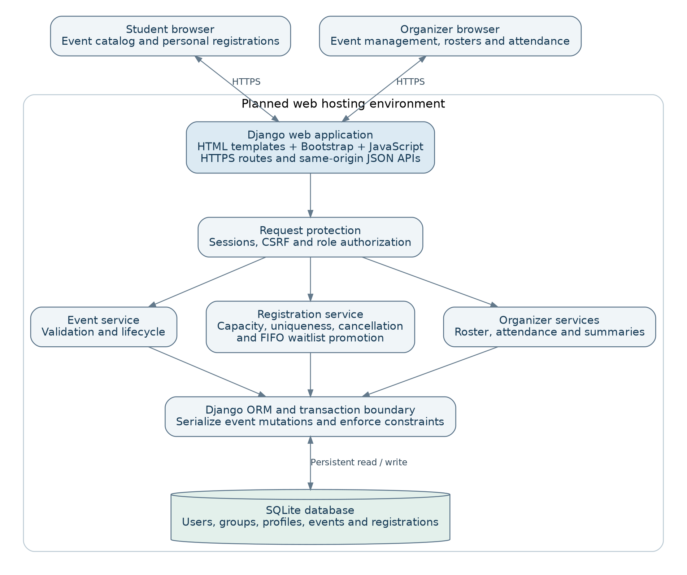
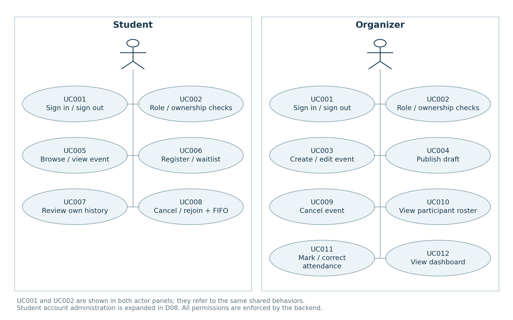
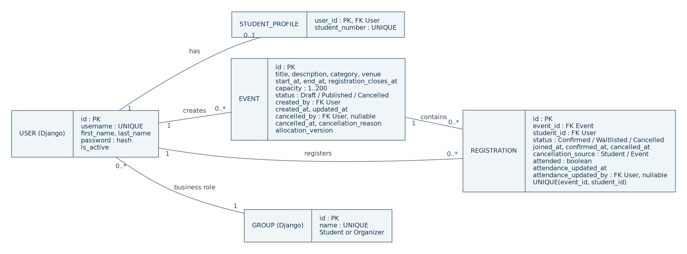
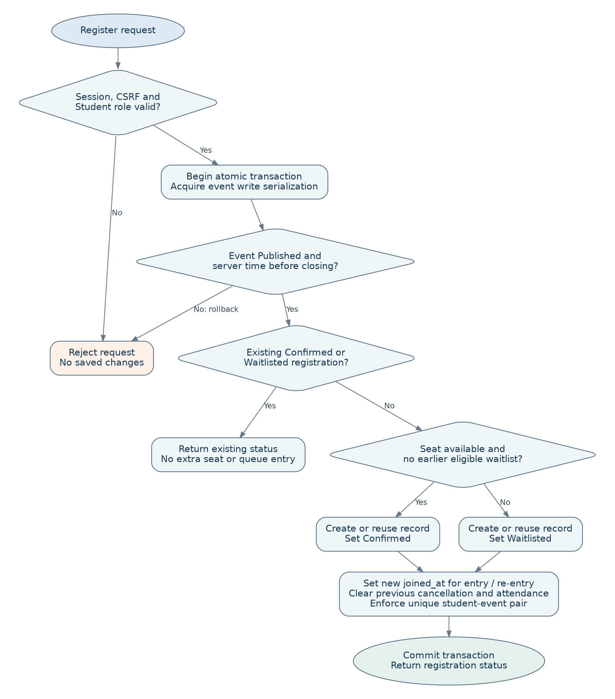
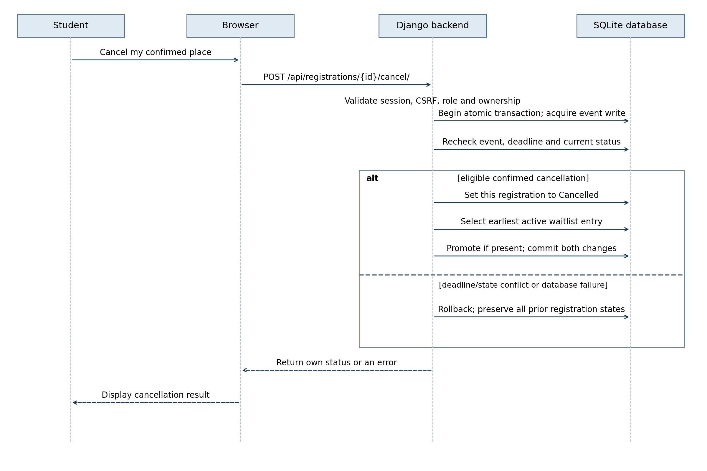
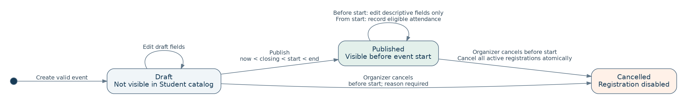
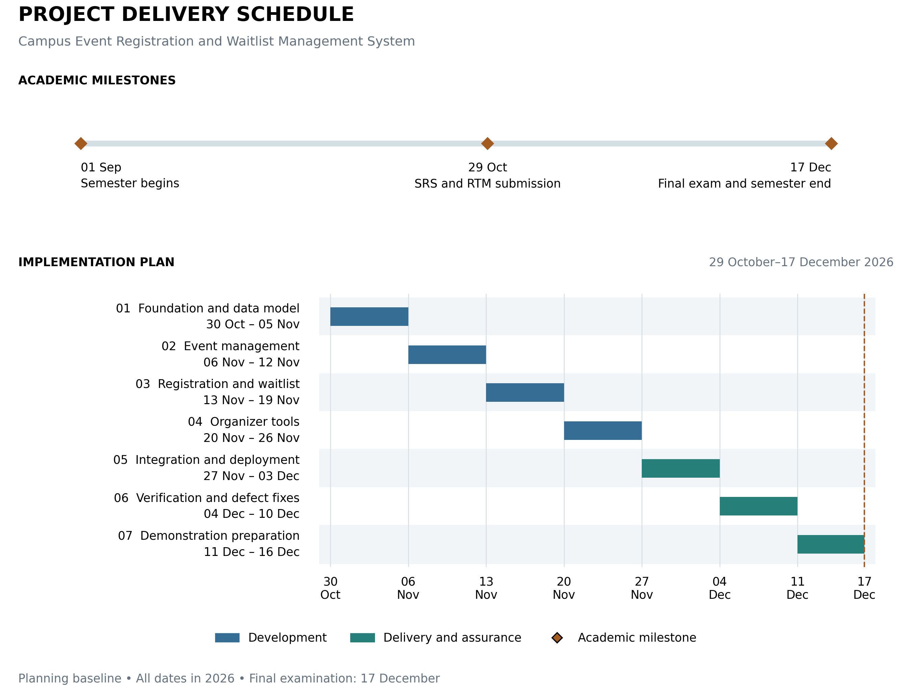

# System diagrams

[Download the complete diagram PDF](System_Diagrams.pdf)

These design diagrams correspond to SRS version 1.0 and the RTM requirements. They specify intended behavior and do not assert that implementation is complete. Prepared 18 November 2026.

| Diagram | Purpose | Source |
| --- | --- | --- |
| [System architecture](01_system_architecture.png) | SRS 2.1, 3.1, 4.2 | NFR002, NFR003, NFR005, NFR006 | [Editable source](source/01_system_architecture.dot) |
| [Use case diagram](02_use_cases.png) | SRS 3.2 and 5.1 | UC001-UC012 | FR001-FR018 | [Editable source](source/02_use_cases.dot) |
| [Entity relationship diagram](03_entity_relationships.png) | SRS 4.1 | FR001, FR003-FR018 | NFR003 | [Editable source](source/03_entity_relationships.dot) |
| [Registration activity diagram](04_registration_activity.png) | SRS 3.2 and 4.1.2-4.1.3 | FR009, FR010, FR018 | TC009, TC010, TC018, TC021 | [Editable source](source/04_registration_activity.dot) |
| [Cancellation and waitlist promotion](05_cancellation_sequence.png) | SRS 5.2 | FR012-FR013 | TC012-TC013, TC021 | [Editable source](source/05_cancellation_sequence.py) |
| [Event lifecycle diagram](06_event_lifecycle.png) | SRS 3.2 and 4.1.2 | FR004-FR006, FR014, FR016 | [Editable source](source/06_event_lifecycle.dot) |
| [Project Gantt chart](07_project_gantt.png) | SRS 7.4 | Original planning baseline dated 29 October 2026 | [Original SRS](../srs/SRS.docx) |

## System architecture

SRS 2.1, 3.1, 4.2 | NFR002, NFR003, NFR005, NFR006

Browser input is validated by the backend. Allocation and promotion execute during requests; no background scheduler is required. This is the planned architecture, not evidence of a live deployment.

## Use case diagram

SRS 3.2 and 5.1 | UC001-UC012 | FR001-FR018

UC002 is a cross-cutting authorization constraint. UC008 triggers promotion only when a confirmed place is released before registration closes. Student accounts cannot access organizer rosters or other students' registration records.

## Entity relationship diagram

SRS 4.1 | FR001, FR003-FR018 | NFR003

Cardinalities show the application rules: each account has exactly one business role, and every Student has a profile. Django implements group membership through its standard join table (omitted). Secondary audit relationships for cancellation and attendance are listed as foreign keys.

## Registration activity diagram

SRS 3.2 and 4.1.2-4.1.3 | FR009, FR010, FR018 | TC009, TC010, TC018, TC021

The event state, deadline, seat count, and queue are checked within the transaction. Any write failure rolls back all changes; temporary database contention returns a retryable error. Rejoining reuses the existing record and resets queue priority.

## Cancellation and waitlist promotion

SRS 5.2 | FR012-FR013 | TC012-TC013, TC021

Sequence shown: first cancellation of a Confirmed registration. A Waitlisted cancellation does not promote anyone. A repeated cancellation returns the existing Cancelled result without releasing another place. Promoted students see their new status on refresh; their identity is not exposed to the cancelling student.

## Event lifecycle diagram

SRS 3.2 and 4.1.2 | FR004-FR006, FR014, FR016

Publication fixes capacity and all event times. Registration closes when server time reaches registration_closes_at; this does not create a new event state. Past events remain Published unless cancelled. Event cancellation never promotes the waitlist. Attendance requires a non-cancelled event and a Confirmed registration.

## Project Gantt chart

SRS 7.4 | Original planning baseline dated 29 October 2026

The chart is reproduced from the SRS. It records the original planned dates, not actual progress. The academic semester is 1 September to 17 December 2026; the final exam is 17 December. Update the schedule after both team members confirm current progress.
