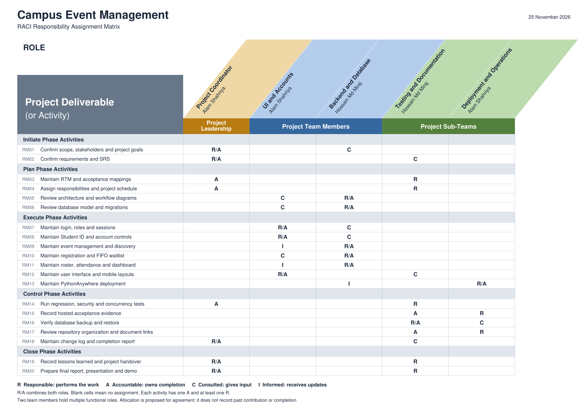

# Campus Event Management - RACI matrix

The responsibility matrix uses the supplied reference layout: slanted role headers, colored functional groups and five project phases.

- [Printable PDF](RACI_Matrix.pdf)
- [Editable Excel workbook](RACI_Matrix.xlsx)

## Team roles

| Group | Role | Team member |
| --- | --- | --- |
| Project Leadership | Project Coordinator | Alam Shahriya |
| Project Team Members | UI and Accounts | Alam Shahriya |
| Project Team Members | Backend and Database | Hossain Md Miraj |
| Project Sub-Teams | Testing and Documentation | Hossain Md Miraj |
| Project Sub-Teams | Deployment and Operations | Alam Shahriya |

This is a two-member project. Multiple columns describe functional roles held by the same two people; the group headings do not imply additional staff.

## RACI key

| Code | Meaning |
| --- | --- |
| R | Responsible: performs the work. |
| A | Accountable: owns the outcome and ensures completion. |
| C | Consulted: provides input. |
| I | Informed: receives updates. |
| R/A | Performs the work and owns completion. |
| Blank | No assignment for that role on that activity. |

Each activity has one A and at least one R. Role allocation is proposed for team agreement. RACI records assigned responsibilities; actual authorship and completed work are evidenced separately through commits, reviews, tests and the RTM.

## Activity assignments

Column abbreviations: PC = Project Coordinator, UI = UI and Accounts, BE = Backend and Database, QA = Testing and Documentation, OP = Deployment and Operations. Names are listed in the role table above.

### Initiate Phase Activities

| ID | Activity | PC | UI | BE | QA | OP |
| --- | --- | --- | --- | --- | --- | --- |
| RM01 | Confirm scope, stakeholders and project goals | R/A |  | C |  |  |
| RM02 | Confirm requirements and SRS | R/A |  |  | C |  |

### Plan Phase Activities

| ID | Activity | PC | UI | BE | QA | OP |
| --- | --- | --- | --- | --- | --- | --- |
| RM03 | Maintain RTM and acceptance mappings | A |  |  | R |  |
| RM04 | Assign responsibilities and project schedule | A |  |  | R |  |
| RM05 | Review architecture and workflow diagrams |  | C | R/A |  |  |
| RM06 | Review database model and migrations |  | C | R/A |  |  |

### Execute Phase Activities

| ID | Activity | PC | UI | BE | QA | OP |
| --- | --- | --- | --- | --- | --- | --- |
| RM07 | Maintain login, roles and sessions |  | R/A | C |  |  |
| RM08 | Maintain Student ID and account controls |  | R/A | C |  |  |
| RM09 | Maintain event management and discovery |  | I | R/A |  |  |
| RM10 | Maintain registration and FIFO waitlist |  | C | R/A |  |  |
| RM11 | Maintain roster, attendance and dashboard |  | I | R/A |  |  |
| RM12 | Maintain user interface and mobile layouts |  | R/A |  | C |  |
| RM13 | Maintain PythonAnywhere deployment |  |  | I |  | R/A |

### Control Phase Activities

| ID | Activity | PC | UI | BE | QA | OP |
| --- | --- | --- | --- | --- | --- | --- |
| RM14 | Run regression, security and concurrency tests | A |  |  | R |  |
| RM15 | Record hosted acceptance evidence |  |  |  | A | R |
| RM16 | Verify database backup and restore |  |  |  | R/A | C |
| RM17 | Review repository organization and document links |  |  |  | A | R |
| RM18 | Maintain change log and completion report | R/A |  |  | C |  |

### Close Phase Activities

| ID | Activity | PC | UI | BE | QA | OP |
| --- | --- | --- | --- | --- | --- | --- |
| RM19 | Record lessons learned and project handover | R/A |  |  | R |  |
| RM20 | Prepare final report, presentation and demo | R/A |  |  | R |  |

## Maintaining this matrix

Edit the role cells on the workbook's RACI sheet. Its Role rule column checks one A and at least one R. A valid check does not mean a task is completed. The Traceability sheet preserves requirement references and review conditions.

The slanted role header is a fixed graphic. Role codes in the matrix body are editable. Changes to the workbook do not automatically update the PDF, PNG or this README; keep all four files consistent when revising assignments.

The RACI activity IDs RM01-RM20 belong to this matrix. Existing SRS/RTM requirement IDs remain unchanged. This update adds the RACI documents only; it does not change the application's code or the reported requirement completion figures.

## References

- Layout: supplied classroom reference image.
- RACI definitions: https://www.smartsheet.com/comprehensive-project-management-guide-everything-raci
- Project requirements and implementation basis: https://github.com/alamshahriya1-cpu/campus-event-management/tree/8c3901dd0717095395c9c10e22954b14a0c80581

Prepared 25 November 2026. Version 2.0.
